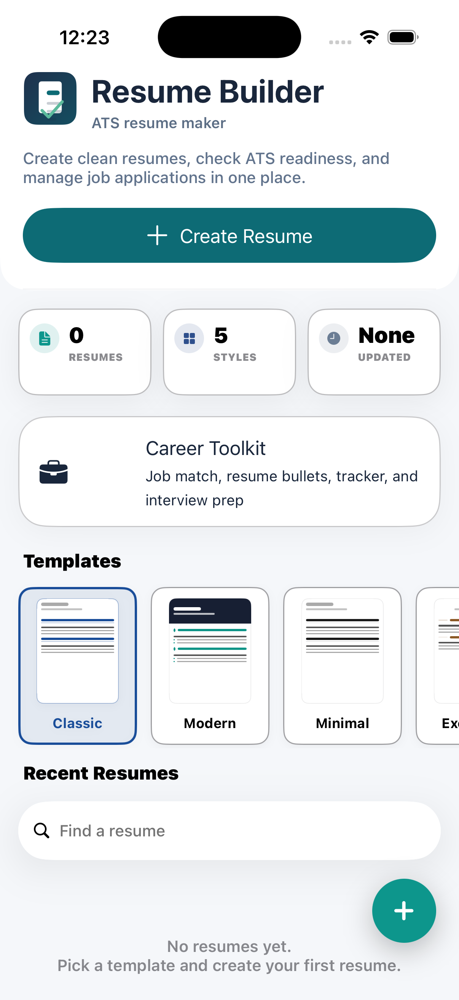
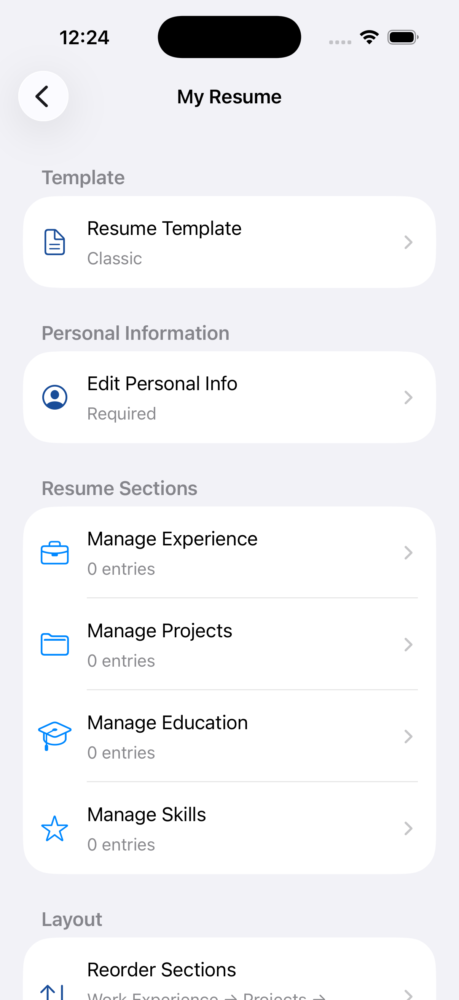
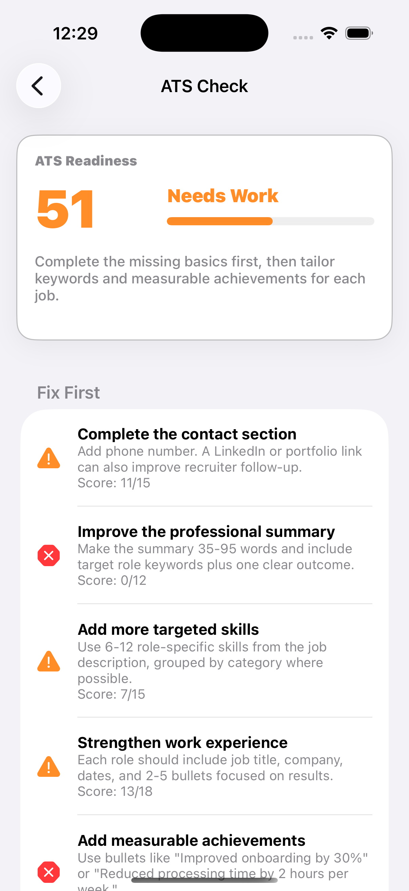

# Resume Builder (UIKit + Swift)

A complete iOS resume builder app built with **Swift** and **UIKit** (no SwiftUI).

## Location

```
~/Desktop/ResumeBuilder/
```

## Features

- **5 resume templates** — Classic, Modern, Minimal, Executive, Creative
- **Redesigned home screen** — template picker + resume cards with edit/delete
- Create and manage multiple resumes
- Edit personal information (name, email, phone, address, LinkedIn, website, summary)
- Work experience, **projects**, education, and skills — each with **edit + delete**
- **Reorder sections** — drag to reorder Experience, Projects, Education, Skills
- Preview formatted resume on screen (respects template + section order)
- Export resume as PDF and share via AirDrop, email, Files, etc.
- **Auto-saves** — changes persist immediately (no data loss on back navigation)

## Requirements

- macOS with **Xcode 15+** installed (full Xcode, not just Command Line Tools)
- iOS 15.0+ (iPhone or iPad simulator/device)

## How to Run

1. Open Xcode
2. Go to **File → Open** and select:
   ```
   ~/Desktop/ResumeBuilder/ResumeBuilder.xcodeproj
   ```
3. Select an iPhone simulator (e.g. iPhone 15)
4. Press **⌘R** to build and run

## Project Structure

```
ResumeBuilder/
├── AppDelegate.swift          # App entry point
├── SceneDelegate.swift        # Window & navigation setup
├── Models/                    # Resume data models
├── Services/                  # Storage & PDF generation
├── ViewControllers/           # All UIKit screens
├── Views/                     # Custom table view cells
└── Resources/                 # Assets & colors
```

## App Flow

1. **Home** — List of saved resumes (swipe to delete, tap + to create new)
2. **Editor** — Sections for Personal Info, Experience, Education, Skills
3. **Preview** — Scrollable formatted resume view
4. **Export** — Generate and share PDF

A sample resume is included on first launch so you can explore the app immediately.

## Tech Stack

- **Language:** Swift 5
- **UI Framework:** UIKit (programmatic UI, no storyboards)
- **Architecture:** MVC
- **Persistence:** FileManager + JSON (Codable)
- **PDF:** UIGraphicsPDFRenderer
## 📸 Screenshots

### Home Screen



### Resume Editor



### Resume Preview


### ATS Checker



### Career Toolkit


